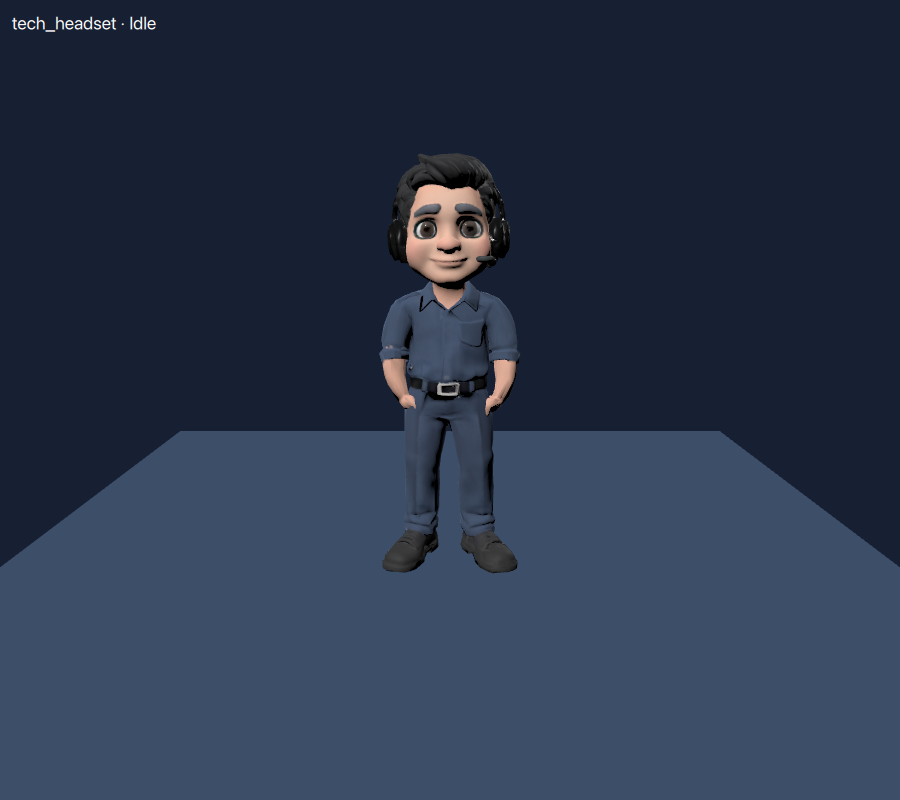
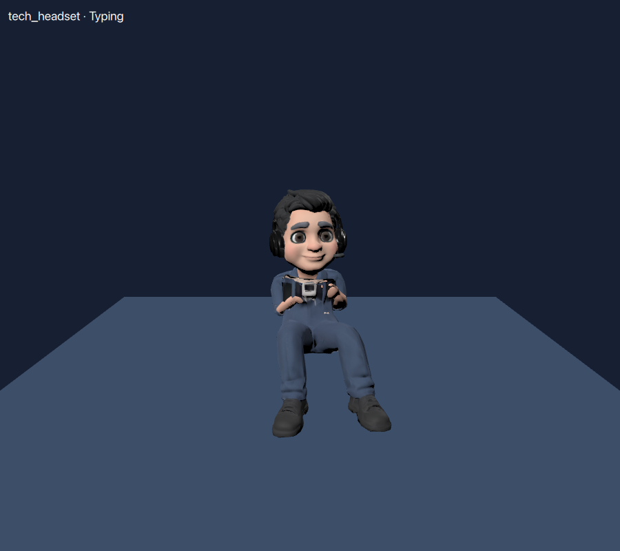
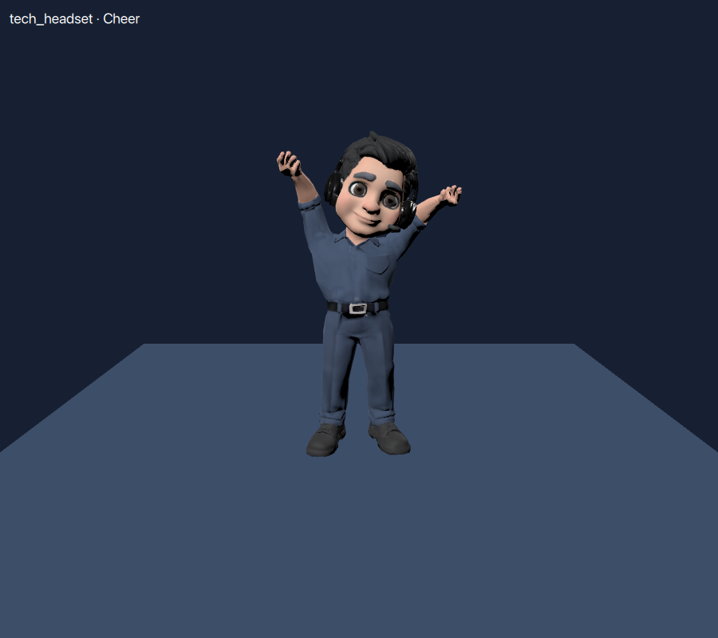

# Character refresh

The five shipped character identities retain their asset IDs and `Idle`, `Typing`, and `Cheer` clip names.
Geometry is regenerated from the original source images with QtMeshEditor 3.67.0, TRELLIS.2 balanced,
BiRefNet background removal (`--matting best`), `--no-source`, a 20,000 triangle target and 2048 texture setting.
UniRig predicts each skeleton; SkinTokens computes four-influence skin weights. Kimodo native generates
motion from descriptive action prompts and retargets it to each character's own skeleton.

| Clip | Motion | Playback | Hands |
|---|---|---|---|
| Idle | Standing quietly, breathing gently, arms relaxed at the sides | Seamless loop | Relaxed |
| Typing | Seated at a desk, working on a computer with both hands | Seamless loop | Auto from prompt |
| Cheer | Raise both arms in celebration, then return to standing | Once | Open |

Horizontal root travel is disabled; vertical movement is preserved. Kimodo motion files and generation
reports are cached locally with a key derived from the prompt, duration, hand mode, loop settings and seed.
After merge, `scripts/stabilize-cheer-hands.py` aims Cheer palms toward the body midline while the
arms are up so the overhead retarget does not turn the backs of the hands toward the head. No
editable generation source sidecars are produced. The unchanged reference images remain in the repository.

The refresh is staged in the ignored `assets/character-refresh/` directory. Installation validates every
mesh, vertex weight, joint reference and animation accessor, verifies the required names and animated
channels, and checks that both looping clips have matching endpoint transforms. All five Qt runtime
imports finish before installation replaces any playable assets. The installer keeps a dated backup of
the original exports, rigs, runtime imports and manifest.

## First character previews





## Commands

```sh
bash scripts/refresh-characters.sh
python3 scripts/validate-character.py assets/character-refresh/rigged/*/*_rigged.glb
python3 scripts/install-character-refresh.py --prepare-only
python3 scripts/review-character-refresh.py
# Inspect the rendered poses before installing.
python3 scripts/install-character-refresh.py
cmake --build --preset desktop --target operacao_ti -j 6
```
